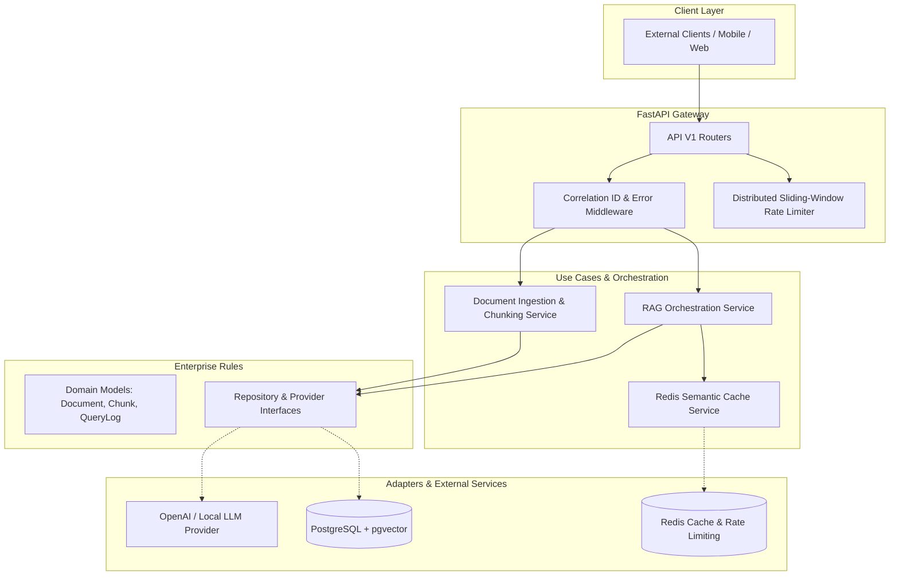
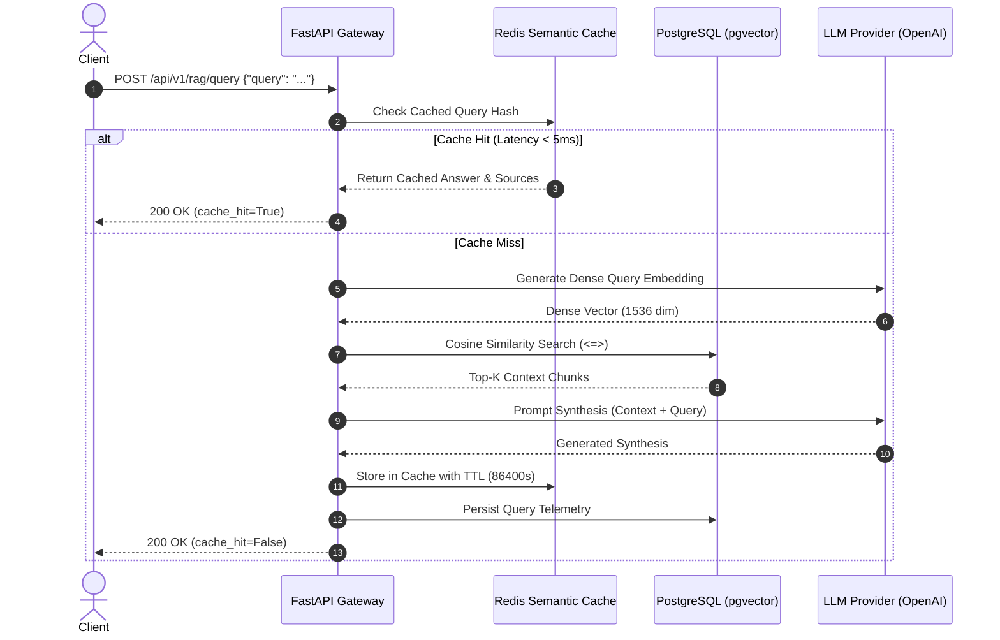

# NexusRAG Core

<p align="center">
  <strong>Enterprise Asynchronous RAG & Semantic Intelligence Platform</strong>
</p>

<p align="center">
  <a href="https://github.com/soheyltaheri/nexus-rag-core/actions/workflows/ci.yml">
    
  </a>
  
  
  
  
  
  
  
</p>

---

## 📌 Overview

**NexusRAG Core** is a production-grade, enterprise-scale Retrieval-Augmented Generation (RAG) backend engineered with **FastAPI**, **PostgreSQL (pgvector)**, and **Redis**. Designed adhering strictly to **Clean Architecture** (Hexagonal / Ports-and-Adapters), it decouples domain business logic from database, caching, and external LLM delivery systems.

### Key Capabilities
- **Strict Clean Architecture:** Explicit segregation into `domain`, `application`, `infrastructure`, and `api` layers.
- **Asynchronous Data Layer:** Non-blocking database operations powered by **SQLAlchemy 2.0 (asyncio)** and **asyncpg**.
- **Native Vector Similarity Search:** Embedding indexing and cosine distance querying utilizing PostgreSQL's **pgvector** extension.
- **Redis Semantic Caching:** Low-latency caching layer that checks semantic and structural query similarity, drastically cutting downstream LLM latency and token costs.
- **Distributed Sliding-Window Rate Limiting:** High-throughput token protection via Redis atomic pipelines.
- **Automated Document Chunking:** Overlapping recursive character text splitting with SHA-256 deduplication.
- **Complete Test Suite & CI/CD:** Comprehensive Unit and Integration tests with **pytest** and a multi-version matrix **GitHub Actions** pipeline.

---

## 🏛️ System Architecture

The project enforces unidirectional dependency flow: outer layers depend on inner abstractions, ensuring business rules remain agnostic of external frameworks.



---

## 🔄 End-to-End RAG Sequence Flow



---

## 📂 Repository Structure

```
nexus-rag-core/
├── .github/
│   └── workflows/
│       └── ci.yml             # GitHub Actions CI/CD matrix pipeline
├── alembic/
│   ├── versions/              # Database migration scripts
│   ├── env.py
│   └── script.py.mako
├── app/
│   ├── api/
│   │   └── v1/
│   │       ├── endpoints/     # HTTP route handlers (health, docs, rag, metrics)
│   │       ├── dependencies.py# Inversion of Control & DI container
│   │       └── router.py
│   ├── application/
│   │   └── services/          # Core business services (RAG, Cache, Ingestion)
│   ├── core/
│   │   ├── config.py          # Pydantic Settings & environment validation
│   │   ├── exceptions.py      # Domain & infrastructure exception taxonomy
│   │   └── logging.py
│   ├── domain/
│   │   ├── models/            # SQLAlchemy 2.0 Declarative Entities
│   │   └── schemas/           # Pydantic DTO request/response contracts
│   ├── infrastructure/        # External adapters (pgvector, Redis, LLM clients)
│   └── main.py                # ASGI application lifespan & entry point
├── tests/
│   ├── conftest.py            # Async fixtures, mock DB, test clients
│   ├── unit/                  # Unit tests (Chunking, Vector math, Caching)
│   └── integration/           # Integration tests (Health, Ingestion, RAG flow)
├── .env.example               # Explicit environment variable documentation
├── docker-compose.yml         # Multi-container production deployment
├── Dockerfile                 # Multi-stage lightweight distroless image
└── pyproject.toml             # Modern package configuration & tool settings
```

---

## 🚀 Quickstart & Deployment

### Option 1: One-Line Docker Deployment (Recommended)

Run the entire stack including **FastAPI API**, **PostgreSQL with pgvector**, and **Redis**:

```bash
docker compose up --build
```

The service will be accessible at:
- **Interactive Swagger Docs:** [http://localhost:8000/docs](http://localhost:8000/docs)
- **ReDoc Documentation:** [http://localhost:8000/redoc](http://localhost:8000/redoc)
- **Health Check Probe:** [http://localhost:8000/api/v1/health](http://localhost:8000/api/v1/health)

---

### Option 2: Local Development Setup

Prerequisites: Python 3.11+ and [uv](https://github.com/astral-sh/uv).

1. **Clone the repository:**
   ```bash
   git clone https://github.com/soheyltaheri/nexus-rag-core.git
   cd nexus-rag-core
   ```

2. **Configure environment:**
   ```bash
   cp .env.example .env
   ```

3. **Install dependencies:**
   ```bash
   uv venv
   source .venv/bin/activate  # On Windows: .venv\Scripts\activate
   uv pip install -e ".[dev]"
   ```

4. **Run migrations:**
   ```bash
   alembic upgrade head
   ```

5. **Start development server:**
   ```bash
   uvicorn app.main:app --reload --port 8000
   ```

---

## 🧪 Testing & Quality Assurance

This repository enforces strict code quality gates, static type verification, and comprehensive automated test coverage:

```bash
# Execute unit and integration tests with coverage report
pytest --cov=app --cov-report=term-missing

# Run Ruff linter
ruff check .

# Validate code formatting
ruff format --check .

# Run static type analysis
mypy app
```

---

## 📡 API Reference

| Method | Endpoint | Description | Auth / Rate Limit |
|---|---|---|---|
| `GET` | `/api/v1/health` | Service, PostgreSQL, and Redis connectivity status | Public |
| `POST` | `/api/v1/documents` | Ingest, chunk, embed, and index new documents | Rate-limited (120 req/min) |
| `GET` | `/api/v1/documents` | List indexed documents with chunk metadata | Public |
| `GET` | `/api/v1/documents/{id}` | Retrieve document details by UUID | Public |
| `POST` | `/api/v1/rag/query` | Execute semantic retrieval + LLM synthesis | Rate-limited (120 req/min) |
| `GET` | `/api/v1/metrics` | Operational stats (cache hit %, latency, totals) | Public |

### Example RAG Query Request

```bash
curl -X POST "http://localhost:8000/api/v1/rag/query" \
     -H "Content-Type: application/json" \
     -d '{
       "query": "What are the core benefits of Clean Architecture in FastAPI?",
       "top_k": 3,
       "enable_cache": true
     }'
```

---

## 📄 License

This project is licensed under the [MIT License](LICENSE).
